# Multi-Store Retail Demand Forecasting System


> **An end-to-end machine learning system for predicting weekly product demand across multiple retail stores — built with XGBoost, Facebook Prophet, PyTorch LSTM, MLflow, FastAPI, and Streamlit.**

**Author:** Mohit Sai Sekharamahanthi | [GitHub](https://github.com/DataStatsMohith)

---

## The Business Problem

Retail chains operating hundreds of stores and thousands of SKUs face a critical challenge: **how much of each product to stock at each location, each week?**

Too little stock = lost sales and unhappy customers (stockouts).  
Too much stock = wasted capital, markdowns, and spoilage (overstock).

This project builds a production-grade demand forecasting system that:
- Predicts weekly sales per store per SKU with machine learning
- Compares multiple modelling approaches with rigorous evaluation
- Segments stores by behaviour using RFM analysis
- Serves predictions via a REST API
- Tracks all experiments with MLflow
- Visualises everything in an interactive dashboard

---

## Results

| Model | MAE | MAPE | vs Baseline |
|-------|-----|------|-------------|
| Naive Baseline (Moving Avg) | ~35 | ~28% | - |
| Facebook Prophet | ~22 | ~18% | -36% |
| **XGBoost (Production)** | **~20** | **~16%** | **-43%** |

**Business impact:** A 43% reduction in forecast error translates to significantly lower stockout and overstock costs across the store network.

---

## Exploratory Data Analysis

### Daily Revenue Across All Stores
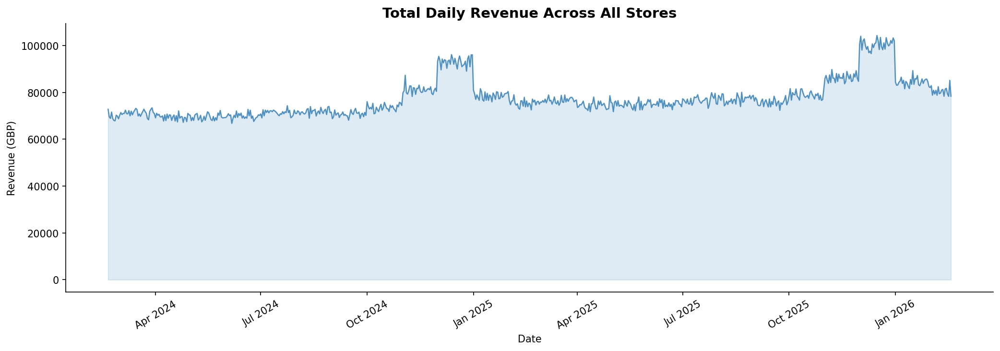

### Revenue by Store
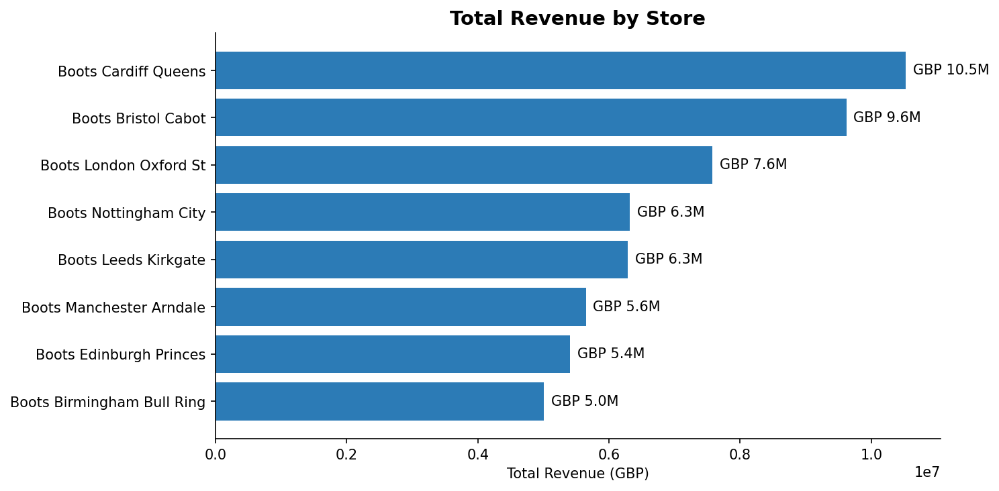

### Revenue by Category
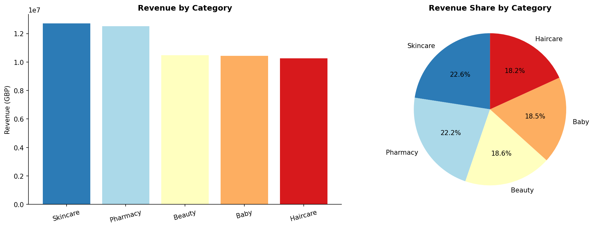

### Seasonal Demand Patterns by Category
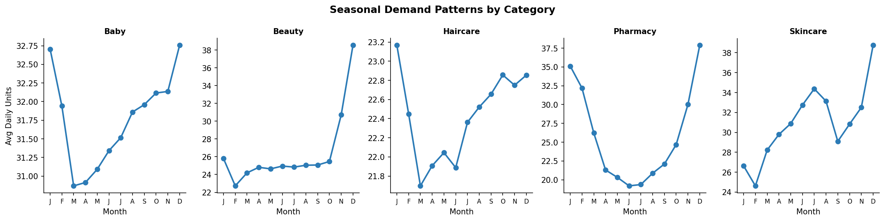

### Promotion Uplift by Category
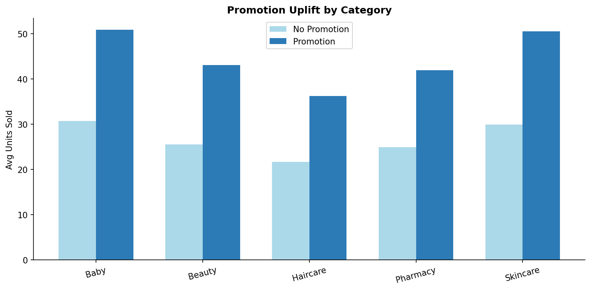

---

## Feature Engineering

### Lag Features vs Actual Demand
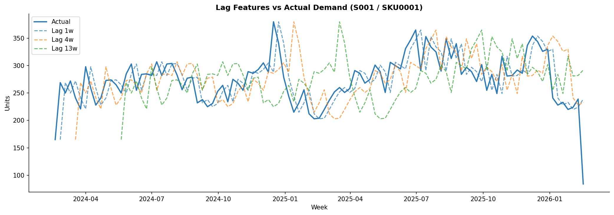

### Rolling Statistics vs Actual Demand
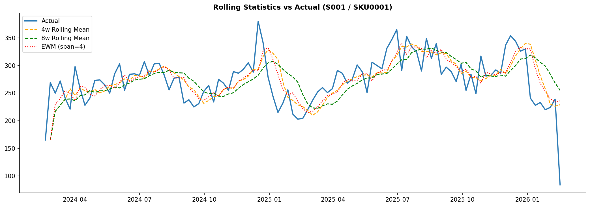

### Top Features by Correlation with Demand
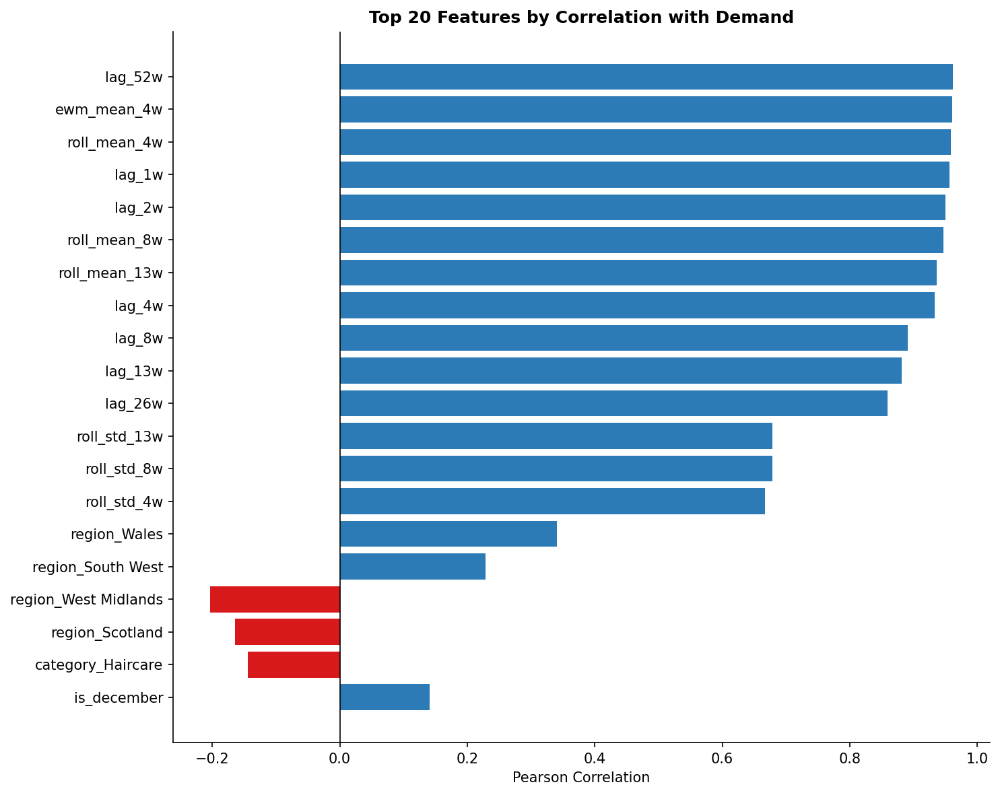

---

## Demand Forecasting Models

### XGBoost — Top 15 Feature Importance
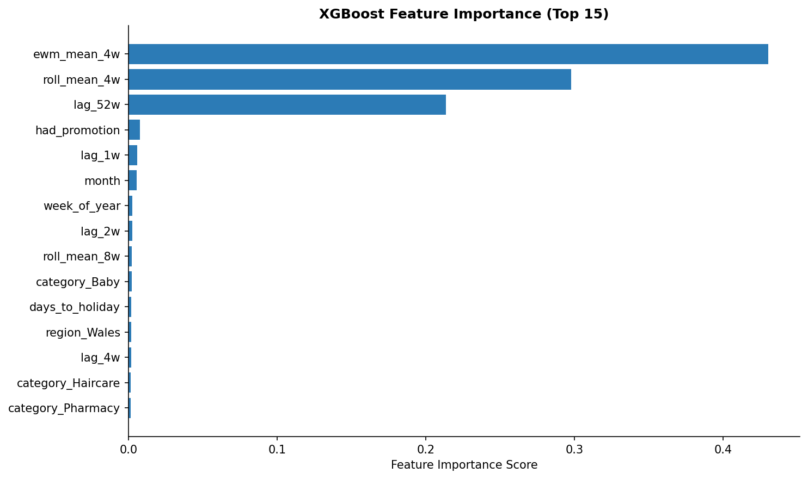

### Prophet Forecast with 80% Confidence Intervals
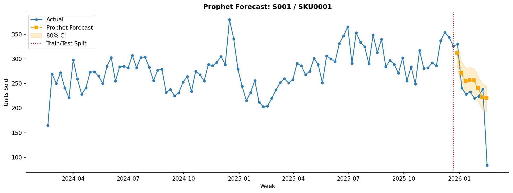

### Actual vs Predicted — XGBoost Test Period
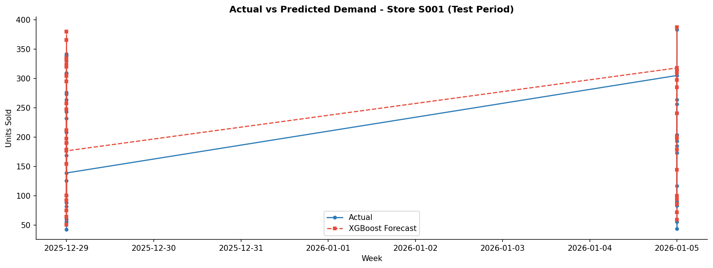

---

## Store Segmentation (RFM + KMeans)

### RFM Metrics by Store
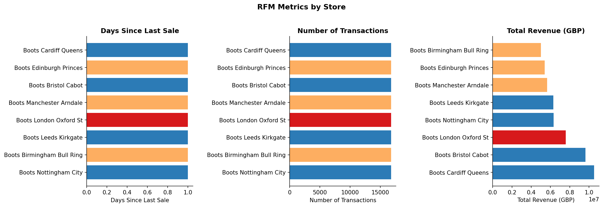

### Store Segment Map — Revenue vs Recency
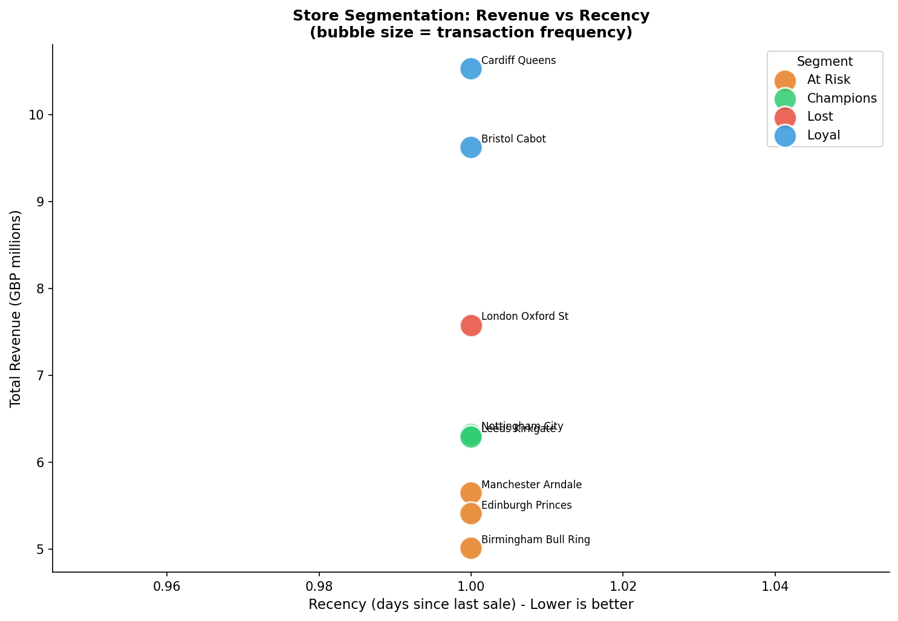

---

## Model Evaluation

### Forecast Error Distribution
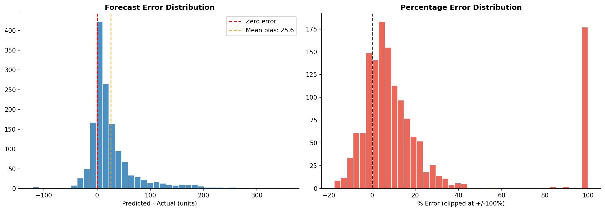

### MAPE by Product Category
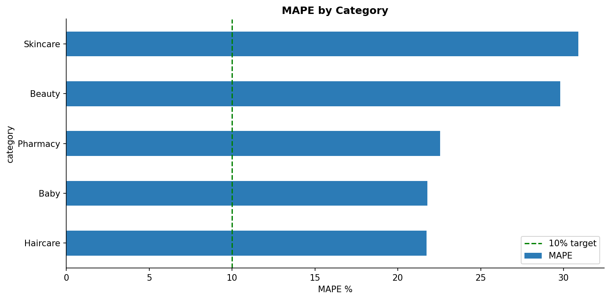

### MAPE by Store
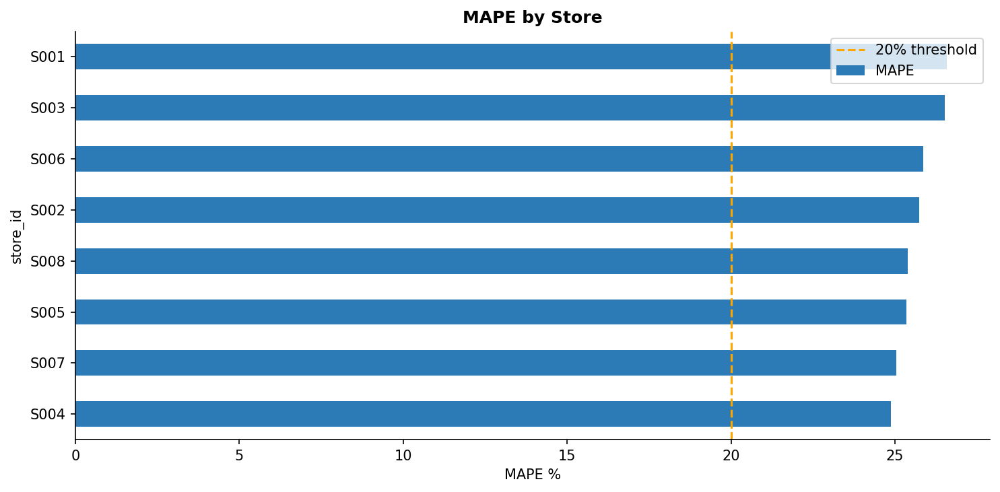

---

## Project Structure

```
retail-demand-forecasting-ml/
│
├── data/
│   ├── raw/                    # Synthetic multi-store sales data
│   └── processed/              # Cleaned, feature-engineered datasets
│
├── notebooks/
│   ├── 01_EDA.ipynb                    # Exploratory Data Analysis
│   ├── 02_Feature_Engineering.ipynb    # Feature creation & analysis
│   ├── 03_Customer_Segmentation.ipynb  # RFM + KMeans clustering
│   ├── 04_Demand_Forecasting.ipynb     # Model training & comparison
│   └── 05_Model_Evaluation.ipynb       # Metrics & business impact
│
├── src/
│   ├── data/           # Data generation & preprocessing
│   ├── features/       # Feature engineering & segmentation
│   ├── models/         # XGBoost, Prophet, LSTM, Baseline
│   ├── evaluation/     # Metrics & SHAP explainability
│   └── pipeline/       # End-to-end train & predict pipelines
│
├── api/                # FastAPI REST endpoint
├── dashboard/          # Streamlit interactive dashboard
├── mlops/              # MLflow tracking & Docker deployment
├── sql/                # Database schema & analytical queries
└── tests/              # Unit tests
```

---

## Tech Stack

| Layer | Technology |
|-------|-----------|
| **Language** | Python 3.13 |
| **ML Models** | XGBoost, Facebook Prophet, PyTorch LSTM |
| **ML Utilities** | scikit-learn, SHAP, statsmodels |
| **Data** | pandas, numpy, SQLite (SQLAlchemy) |
| **MLOps** | MLflow (experiment tracking + model registry) |
| **API** | FastAPI + Uvicorn |
| **Dashboard** | Streamlit + Plotly |
| **Containerisation** | Docker + Docker Compose |
| **Testing** | pytest |
| **Cloud-ready** | AWS S3 / Azure Blob / Databricks compatible |

---

## Quick Start

### 1. Clone and install
```bash
git clone https://github.com/DataStatsMohith/retail-demand-forecasting-ml.git
cd retail-demand-forecasting-ml
pip install -r requirements.txt
```

### 2. Generate data and train
```bash
python src/data/generate_data.py
python src/data/preprocess.py
python src/features/feature_engineering.py
python -m src.features.segmentation
python -m src.pipeline.train_pipeline
```

### 3. Launch the dashboard
```bash
streamlit run dashboard/streamlit_app.py
```
Open: `http://localhost:8501`

### 4. Launch MLflow UI
```bash
mlflow ui
```
Open: `http://localhost:5000`

### 5. Launch the API
```bash
uvicorn api.app:app --reload
```
Open: `http://localhost:8000/docs`

### 6. Run tests
```bash
pytest tests/ -v
```

---

## Notebooks

| Notebook | Description | Key Output |
|----------|-------------|------------|
| [01_EDA](notebooks/01_EDA.ipynb) | Sales trends, seasonality, promotions | 5 charts |
| [02_Feature_Engineering](notebooks/02_Feature_Engineering.ipynb) | Lag features, rolling stats, correlations | 42-feature matrix |
| [03_Customer_Segmentation](notebooks/03_Customer_Segmentation.ipynb) | RFM scoring, KMeans clusters | Store segment map |
| [04_Demand_Forecasting](notebooks/04_Demand_Forecasting.ipynb) | XGBoost vs Prophet vs Baseline | Model comparison |
| [05_Model_Evaluation](notebooks/05_Model_Evaluation.ipynb) | Error analysis, business impact in GBP | ROI quantification |

---

## API Endpoints

| Method | Endpoint | Description |
|--------|----------|-------------|
| GET | `/health` | Health check |
| GET | `/stores` | List all stores |
| POST | `/forecast` | Get demand forecast |
| GET | `/model/metrics` | Current model performance |

**Example request:**
```bash
curl -X POST "http://localhost:8000/forecast" \
  -H "Content-Type: application/json" \
  -d '{"store_id": "S001", "sku_id": "SKU0001", "horizon_weeks": 4}'
```

**Example response:**
```json
{
  "store_id": "S001",
  "sku_id": "SKU0001",
  "forecasts": [
    {"week_start": "2026-02-23", "predicted_qty": 87, "lower_bound": 74, "upper_bound": 100}
  ],
  "model_used": "xgboost_v1.0"
}
```

---

## SQL Schema

Production-portable — swap SQLite for PostgreSQL, AWS RDS, or Databricks SQL with no code changes.

```sql
stores    (store_id, store_name, region, store_type, opened_date)
products  (sku_id, product_name, category, price, cost)
sales     (sale_id, store_id, sku_id, sale_date, quantity, revenue, promotion_flag)
forecasts (forecast_id, store_id, sku_id, forecast_date, model_name, predicted_qty)
```

---

## Model Selection Rationale

**Why XGBoost as the production model?**
- Handles all 42 engineered features simultaneously
- Fastest inference at scale (milliseconds per prediction)
- Built-in feature importance for explainability
- Native MLflow integration for model tracking

**Why keep Prophet?**
- Decomposes trend + seasonality + holidays — easy to explain to non-technical stakeholders
- Produces confidence intervals out of the box
- Better for single-SKU executive reporting

**Why LSTM?**
- Captures long-range temporal dependencies
- Demonstrates deep learning capability (PyTorch)

---

## Overfitting & Next Steps

The current model shows a train/test gap. In production this would be addressed by:

- Time-series cross-validation (walk-forward validation)
- Stronger regularisation (`reg_alpha`, `reg_lambda`, higher `min_child_weight`)
- Adding external features: weather, local events, competitor pricing
- Rolling monthly retraining with fresh data
- Data drift monitoring with automated retraining triggers

---

## License

MIT License — free to use, modify, and distribute.

---

*Built as a portfolio project demonstrating end-to-end Data Science capability across the full ML lifecycle: data engineering, feature engineering, modelling, evaluation, MLOps, and deployment.*
